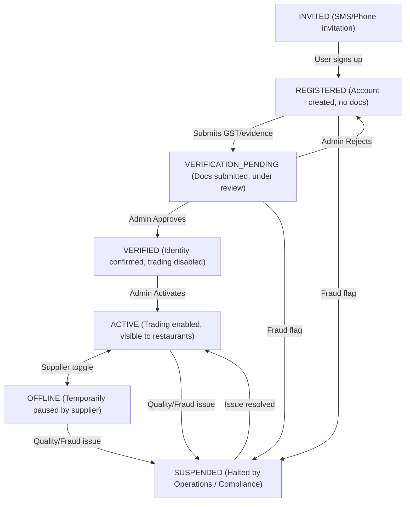

# Supplier Lifecycle, Verification & Marketplace Discovery

This guide explains how supplier onboarding, verification, and activation work across **Costonomy Mandi**, how suppliers become visible to restaurants, and how to verify and activate suppliers during local development and testing.

> **Since Marketplace API D-208 (common D-85)** the supplier, its stores and its GSTIN live in
> **costonomy-common-api**, not in the Marketplace database. The lifecycle below is no longer stored: the
> Marketplace API derives it from common (claim status, business and enrollment status, the GSTIN's verification,
> and whether the business-wide MARKETPLACE enrollment is `live`) and reports it at
> `GET /api/v1/suppliers/{id}/standing`. The app reads it there and never computes it.

---

## 1. Core Principles

1. **Verification $\neq$ Activation (Separation of Concerns)**:
   - **`VERIFIED`**: Confirms *who* the business is (tax compliance, GSTIN authenticity, legal entity name). A verified supplier **cannot** yet trade.
   - **`ACTIVE`**: An explicit operational decision to permit the supplier to publish catalogs, receive orders, and appear in restaurant search.
2. **Marketplace Discovery Guardrail**:
   - Restaurants and kitchens **only see suppliers and stores that are `ACTIVE`**.
   - If a supplier is in `REGISTERED`, `VERIFICATION_PENDING`, or `VERIFIED`, neither their stores nor their SKUs appear in restaurant searches or product comparisons.
3. **One GSTIN, One Supplier**:
   - The GSTIN is one of the business's identifiers in common. Registering a supplier whose GSTIN or phone matches
     one a restaurant already listed is refused with `CLAIM_CANDIDATES_EXIST` (the app explains and offers to
     register anyway); taking over the listed one is a claim, handled by support.
   - Once verified, the GSTIN is locked (common refuses to change a verified identifier).

---

## 2. Supplier Lifecycle State Machine



### State Transitions Table

| Current State | Allowed Next States | Trigger / Actor |
|---|---|---|
| `INVITED` | `REGISTERED` | Supplier user registers via OTP flow. |
| `REGISTERED` | `VERIFICATION_PENDING`, `SUSPENDED` | Supplier sends the GSTIN to common's verification queue (`submitGstinVerification`). |
| `VERIFICATION_PENDING` | `VERIFIED`, `REGISTERED`, `SUSPENDED` | Platform Admin reviews: **Approve** moves to `VERIFIED`; **Reject** returns to `REGISTERED` so errors can be corrected. |
| `VERIFIED` | `ACTIVE`, `SUSPENDED` | Platform Admin explicitly activates the supplier (`activate`). |
| `ACTIVE` | `OFFLINE`, `SUSPENDED` | Supplier sets a store offline (its MARKETPLACE `online` setting in common), or operations suspends. |
| `OFFLINE` | `ACTIVE`, `SUSPENDED` | Supplier sets the store online again. |
| `SUSPENDED` | `ACTIVE` | Operations reinstates after resolving dispute/audit. |

---

## 3. What Makes a Supplier "Verified"?

A supplier becomes **`VERIFIED`** when:

1. **Valid Tax Identification (`GSTIN`)**:
   - A 15-character Indian Goods & Services Tax Identification Number (e.g. `36AAACH7409R1Z3`).
   - Verified against government tax registries.
2. **Matching Legal Name**:
   - `legalName` matches the legal entity name on the GST registration.
3. **Verification History**:
   - Every submission is a verification request in common (`GET /v1/orgs/{id}/verifications`): who submitted, when,
     what was claimed, who reviewed it, and why.
4. **Operator Approval**:
   - Costonomy staff decide the request in common's verification queue.

---

## 4. API Endpoints

### Supplier-Facing (costonomy-common-api, the user's token)

- **Register the business with its first store, enrolled in the marketplace** (send an `Idempotency-Key`):
  ```http
  POST /v1/orgs
  { "orgType": "SUPPLIER", "displayName": "…", "legalName": "…", "gstin": "36AAACH7409R1Z3",
    "contactName": "…", "contactPhone": "…", "enrollApps": ["MARKETPLACE"],
    "firstOutlet": { "kind": "STORE", "name": "…", "addressLine1": "…", "city": "…", "stateCode": "IN-TG",
                     "pincode": "500001", "latitude": 17.38, "longitude": 78.48, "contactName": "…",
                     "contactPhone": "…" } }
  ```
  The GSTIN is recorded as an unverified identifier. MARKETPLACE enrollment needs every field of `firstOutlet`
  shown, including the coordinates for a store (`ENROLLMENT_REQUIREMENTS_UNMET` otherwise).
- **Add a store**: `POST /v1/orgs/{id}/outlets` (`kind: "STORE"`).
- **Submit the GSTIN for verification**:
  ```http
  GET  /v1/orgs/{id}/identifiers              → the GSTIN identifier's id
  POST /v1/orgs/{id}/verifications
  { "subjectType": "BUSINESS_IDENTIFIER", "subjectId": <identifier id>, "checkType": "GSTIN",
    "data": { "legalName": "…", "gstin": "…" } }
  ```
- **View verification history**: `GET /v1/orgs/{id}/verifications`.

### Marketplace API

- **Standing** (lifecycle, verification, `canTrade`, and each store's status and whether it takes orders):
  ```http
  GET /api/v1/suppliers/{supplierId}/standing
  ```

### Operations

- **Review a verification**: common's verification queue (Costonomy staff).
- **Activate for trading**: `POST /api/v1/admin/suppliers/{supplierId}/activate` on the Marketplace API, which sets
  the business-wide MARKETPLACE enrollment `live` in common. Verification never activates on its own.

---

## 5. How Restaurants Discover Suppliers

When a restaurant browses the app (on `http://localhost:7071`):

1. **Database Query Filtering**:
   The storefront catalog query explicitly filters by active states:
   ```sql
   SELECT s.id, o.display_name, s.name, s.city, s.latitude, s.longitude
     FROM supplier_store s
     JOIN supplier_organization o ON o.id = s.supplier_organization_id
    WHERE s.status = 'ACTIVE'
      AND o.lifecycle_status = 'ACTIVE';
   ```
2. **Geographic Scoping**:
   - Suppliers are matched to the restaurant's active **Outlet** location.
   - The default directory radius is **10 km** from the outlet's coordinates.
3. **Mobile App Navigation**:
   - **Supplier Directory**: `http://localhost:7071/restaurant/search` &rarr; click **"Suppliers"** tab.
   - **Compare Suppliers**: `http://localhost:7071/restaurant/discover` &rarr; tap any product card (e.g. *Paneer*) to see all active suppliers offering that product side-by-side.
   - **Direct Storefront**: `http://localhost:7071/restaurant/supplier/{storeId}`.

---

## 6. Local Development & Testing Quickstart

The Marketplace database no longer has `supplier_organization`, `supplier_store` or `supplier_verification`; the SQL
that used to be here no longer applies. Locally:

1. Look at a supplier's standing: `GET http://localhost:7070/costonomy-mp-api/api/v1/suppliers/{id}/standing` with the
   supplier's token.
2. Approve its GSTIN verification in common's verification queue (common's dev console, or its admin API).
3. Activate it: `POST /api/v1/admin/suppliers/{id}/activate` with an operations token.

After that, refresh `http://localhost:7071/restaurant/search` &rarr; the supplier appears under the **Suppliers** tab.
